# Business Intelligence Analytics Admin — v0.1.5
## You can create a chart or pivot table faster than it takes to type it into AI

## Overview

Analytics Admin is a multi-user business intelligence platform that allows organizations to connect to their databases, model data views, and build interactive dashboards. Each user operates within an isolated workspace, with dedicated connectors, views, and dashboards.

---

## Dashboards

- Tabular display of data sourced from a view
- Automatic removal of NULL values from displayed results
- Conditional formatting of numeric values: positive values shown in green, negative values shown in red
- Support for numeric and date/time formatting
- Configurable row limits
- Automatic detection of data types to generate appropriate filtering conditions for a view
- Column order defined in the dashboard settings (**Columns** list, up/down arrows or drag and drop) is applied to the table and saved with the dashboard
- The **View/Table** picker refreshes automatically whenever a view is saved, deleted or shared, without reloading the page

### Pivot Tables

- Creation of pivot (cross-tabulated) tables
- Column hiding and reordering; pivot dimensions keep the order defined under **Dimensions**, while measures and other columns follow the order of the **Columns** list
- Configuration of pivot dimensions and aggregation functions: Sum, Count, Average, Maximum, and Minimum
- Display of columns that are neither assigned as dimensions nor as metrics

### Charts

- Chart creation from a library of 17 predefined chart types
- Configuration of X and Y axes, with support for additional series
- Each series can be independently defined as a column (bar) or a line
- Further breakdown of a series by an additional dimension, based on a selected column
- Ability to show or hide individual values in the chart legend
- Toggle for displaying or hiding gridlines
- Configuration of chart dimensions and layout, including the number of charts displayed per row
- KPI cards with compare columns
- KPI aggregation **Last value (first table row)**: takes the value shown in the top row of the table, respecting the current sorting (including multi-column sorting) and grouping; compared with the same column it uses the second row (e.g. this month against last month)
- Charts are aggregated in the database over all filtered rows, not only the rows loaded into the table
- Chart description (ⓘ in the chart header): a rich-text note (bold, italic, underline, lists, links, highlight and column references that follow column renames), optionally shown as a subtitle under the chart title and included in the PDF export
- **Where the data comes from** is filled in automatically for every chart: view, axes, split, each series with its aggregation, the formula of custom view columns, dashboard filters and view conditions, with a link to open the view in View modeling
- Descriptions are sanitized on the server (allowlist of tags and attributes), so they cannot carry scripts or foreign markup
- The enlarged chart is remembered per dashboard; deleting a chart or KPI card asks for confirmation
 
---

## View Modeling

The view modeling layer allows users to define reusable data structures on top of source tables and views.

- Modeling based on tables and views, with support for subviews
- Selection of the source connector for each view
- One-click exposure of a view as an API endpoint
- API access supports GET requests in both tabular and tree (hierarchical) structures, as well as PUT requests
- **Filtered GET/POST**: send a JSON body with one or more `column: value` pairs to receive only matching rows; if no body is sent, the full view result is returned as before
- Downloadable sample `.bat` script demonstrating API usage
- Renaming of tables and columns to custom aliases directly by clicking on the column header
- Color-coded visual indication when a subview is added to the model
- Column selection for inclusion in a view via checkboxes
- Visual display of join conditions between tables
- Support for adding custom columns and custom conditions, with built-in protection against SQL injection
- Enhanced graphical interface for building WHERE conditions
- Support for ORDER BY and GROUP BY clauses
- Automatic SQL query generation with syntax highlighting
- Live data preview

### View Sharing

Views can be shared with other users and connectors, including connectors pointing to a different database.

- Only the author of a view (the owner of the connector it was saved through) can share it
- Sharing uses the recipient connector's **share code**: the recipient copies it from the connector details and sends it to the author; the author verifies who the code belongs to before sending the invitation
- The recipient sees pending invitations in **View modeling** (with a badge in the menu), previews the view (tables, columns and SQL) and accepts or declines it
- **Same database**: the recipient gets access to the author's view; no copy is created. The database is recognised by looking up the author's view through the recipient's connector, regardless of how the server name is written
- **Different database**: the view is rebuilt and test-run in the recipient's database first; missing tables, columns or permissions are reported and nothing is written. On success a read-only copy is stored in the recipient's `TabObecnyPrehled`
- Shared views are read-only for recipients: they cannot be edited, deleted, overwritten by saving under the same name, or shared further
- When the author saves a new version, recipients in the same database see it immediately; recipients with a copy are offered the update and can accept it or keep the current version
- The author sees the status of every share (waiting, accepted, error) and can revoke it; recipients can remove a shared view from their list. In both cases the view is only hidden, copies are not deleted from the recipient's database
- Shared views appear in the recipient's dashboards and can be exposed through the recipient's own public API (read-only, see Security)

---

## Database Connectors

- Supported database engines: Microsoft SQL Server, MySQL, MariaDB, PostgreSQL, and SQLite
- Allowed IP addresses configurable independently for each connector's API access
- API authentication via bearer key, with a configurable custom header name
- API tenant identifier for connector-level access control
- Configurable maximum request rate (requests per minute)
- Unique share code (UUID) per connector for receiving shared views, with copy-to-clipboard and regeneration; a new code invalidates the old one while shares already accepted remain

---

## Security

- Transport security via SSL, supporting both PEM and PFX certificate formats
- Globally configurable trusted hosts (allowed IP addresses)
- CORS, Content Security Policy (CSP), and HSTS enforcement
- Request and access logging
- JWT secret used for verification of web tokens
- API bearer key and tenant identifier configured individually for each user and each connector
- Trusted host IP addresses configurable independently for each connector
- Configurable maximum request rate (requests per minute)
- Registration and authentication via email, with session validity limited by a defined time period
- Prevention of duplicate concurrent sessions
- Automatic IP blocking on the public API: an invalid API key blocks the client IP immediately, and repeated `400 Bad Request`, `403` or `404` responses within a short time window lead to a persistent block (threshold set by `API_BLOCKLIST_403_404_THRESHOLD`)
- Shared views are served through the recipient connector's own API tenant and key; keys are never shared between connectors, and writing (PUT) through a shared view is reserved for its author

---

## Multi-User Architecture

- Multi-user environment with separated connectors, views, and dashboards per user
- Controlled sharing of views between users and connectors (see View Sharing)
- Account registration and authentication handled exclusively through email
- Multi-language interface: Czech, English, German and French

---

## User Interface

- Sidebar with icon navigation (Dashboards, View modeling, Connectors) and item counts for each list
- Search field that filters dashboards, views and connectors while typing
- Language, background theme and account menu grouped at the bottom of the sidebar
- Resizable sidebar: drag its right edge (or use the arrow keys); the width is remembered per browser and a double-click restores the default
- Row actions (Edit, Share, View) appear on hover so item names use the full width
- Dark background theme support for all sidebar and sharing dialogs

---

## Requirements and Installation

The application is started with the following command:

```
python -m src.web.server
```

Database changes are applied automatically on startup. The metadata database gets the `view_shares` table and a `share_uuid` column on `connectors` (existing connectors receive a code automatically), the `expanded_chart` column on `dashboards` and the `description`, `show_caption`, `description_updated_by` and `description_updated_at` columns on `dashboard_charts`, so the database user needs permission to create and alter tables.

Chart.js and jsPDF are served from `src/web/static/vendor` (see the README there); no external CDN is needed.

### Dependencies

**Core**
- python-dotenv >= 1.0.0

**Data Science**
- numpy >= 1.24.0
- pandas >= 2.0.0
- scipy >= 1.10.0
- scikit-learn >= 1.3.0
- matplotlib >= 3.7.0
- seaborn >= 0.12.0
- jupyter >= 1.0.0
- notebook >= 6.5.0

**Web**
- fastapi >= 0.95.0
- uvicorn >= 0.21.0
- jinja2 >= 3.1.0
- requests >= 2.28.0

**Database**
- pyodbc >= 4.0.0 (MSSQL / SQL Server)
- sqlalchemy >= 2.0.0
- pymssql >= 2.2.0
- pymysql >= 1.0.2 (MySQL / MariaDB connector)
- psycopg2-binary >= 2.9.0 (PostgreSQL connector)
- sqlite3 (SQLite) is included in the Python standard library and requires no separate package

**Office / Export**
- openpyxl >= 3.1.0

**Utilities**
- python-dateutil >= 2.8.0
- tqdm >= 4.65.0
- cryptography >= 41.0.0 (PFX/PKCS12 extraction for HTTPS)

---

## Screenshots

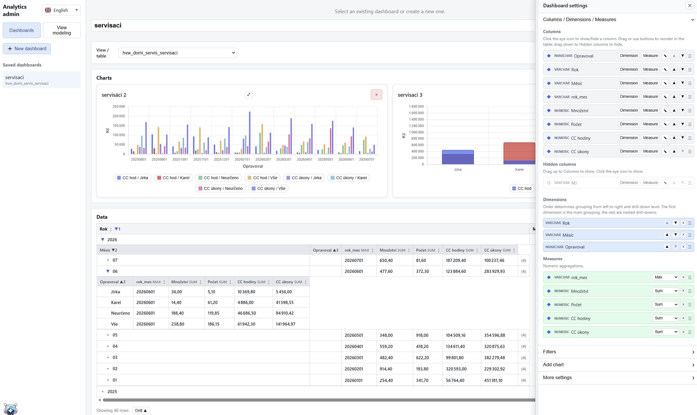

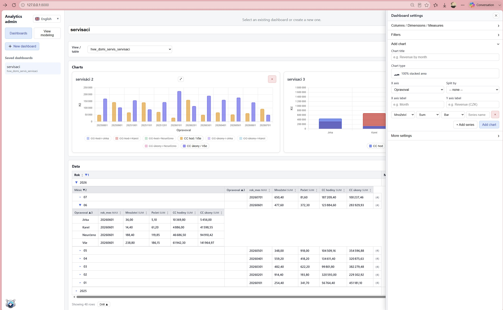

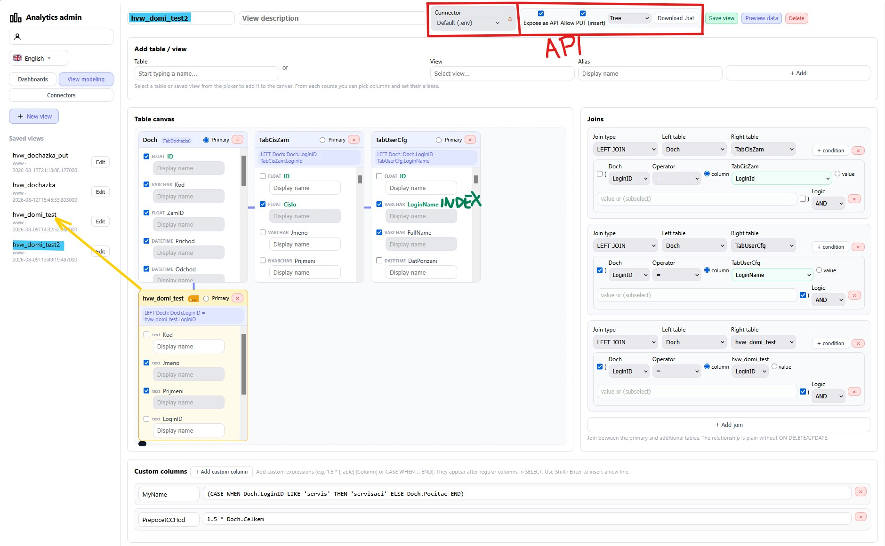

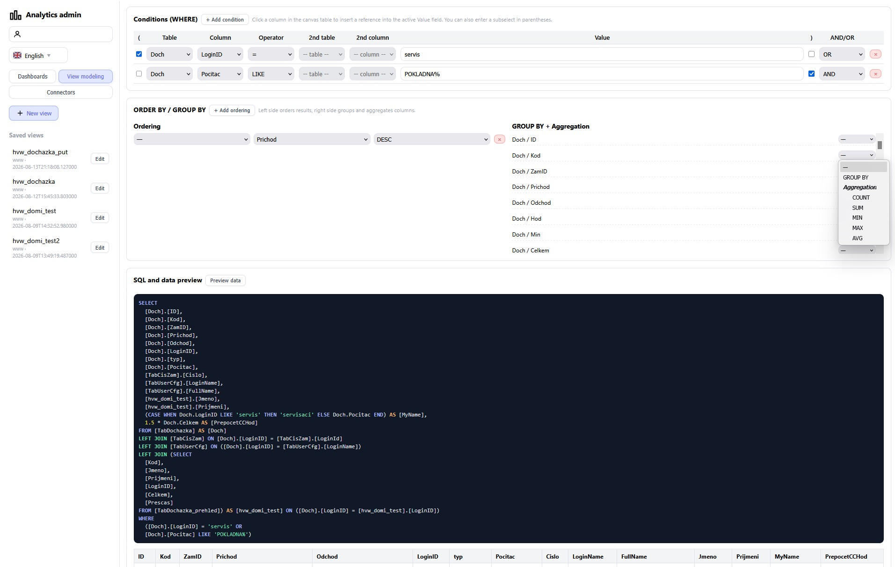

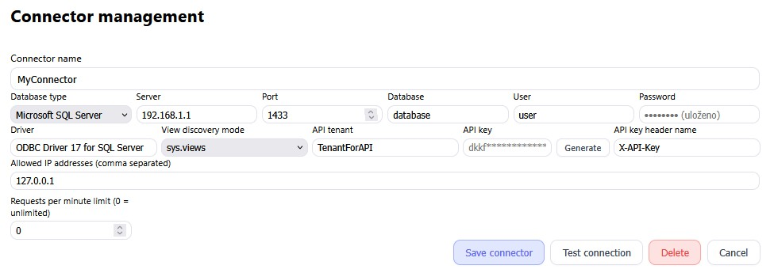

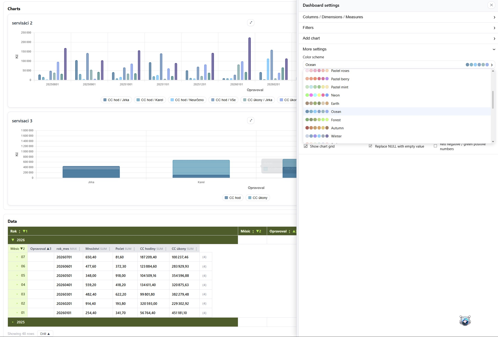

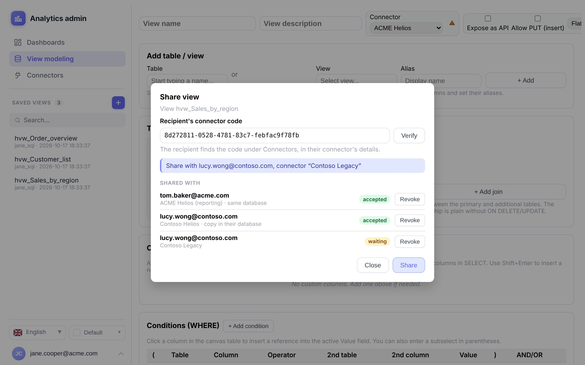

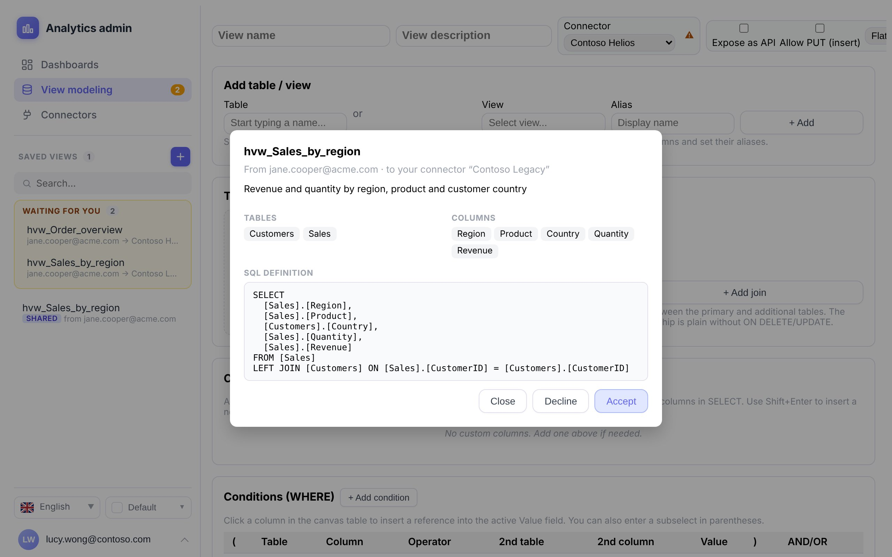

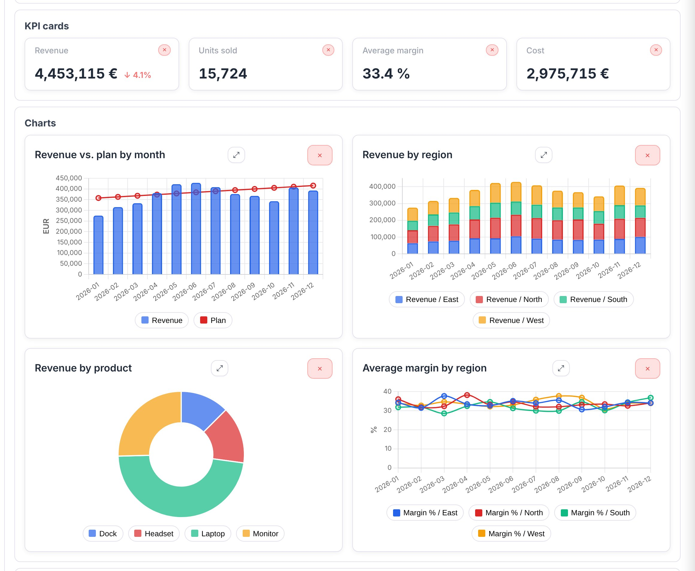

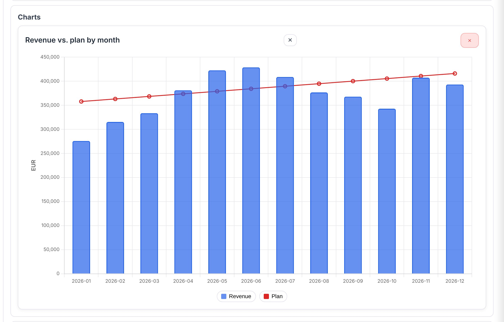


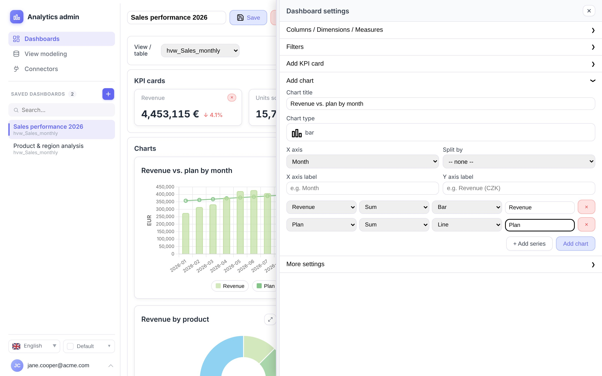

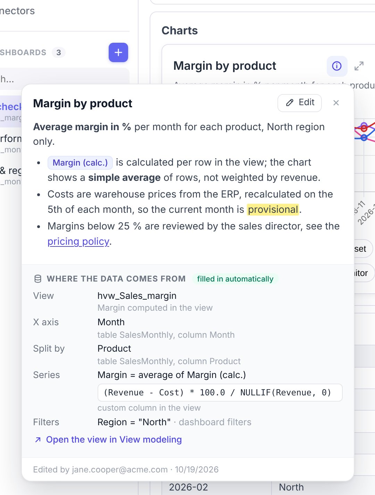

---
